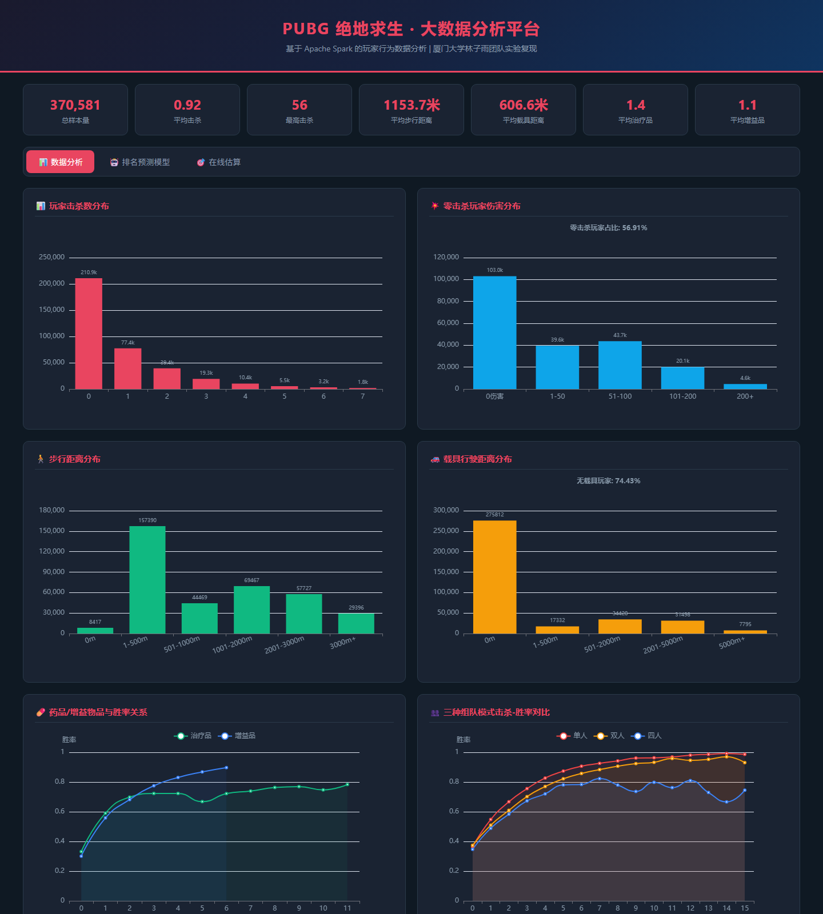
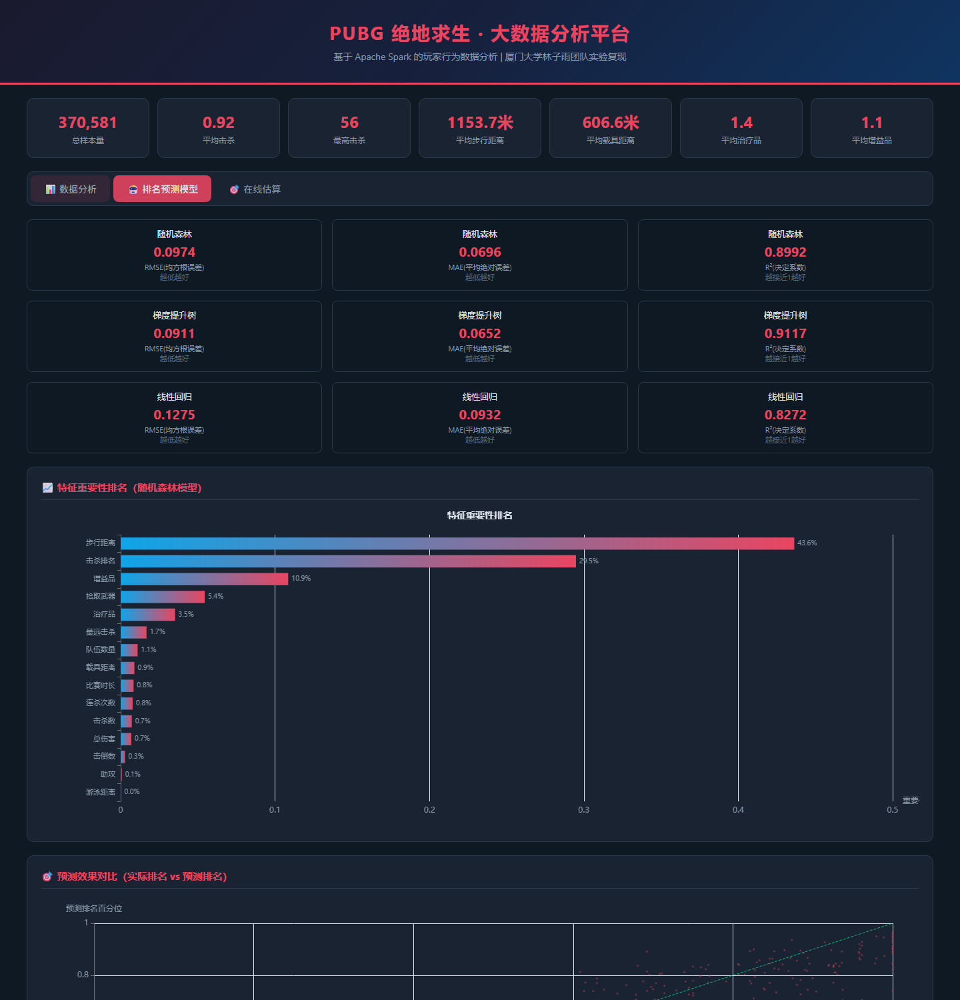

# PUBG 玩家行为分析与排名预测

基于 **PySpark** 对约 **37 万条** PUBG 玩家比赛记录做探索性分析、特征工程与排名百分位预测，并用 **Flask + ECharts** 搭建交互式数据看板。

> 仓库已包含实验数据 `data/smaller_train.csv`（约 50MB），克隆后可直接复现分析与模型。



## 一句话介绍（简历版）

> 基于 PySpark 处理 37 万条 PUBG 玩家行为数据，完成数据清洗、17 维特征工程与排名百分位回归；对比随机森林、GBDT、线性回归，GBDT 测试集 R² 达 0.9117；使用 Flask + ECharts 实现交互式可视化看板。

## 核心工作

- **完整的数据分析链路**：HDFS/本地 CSV → PySpark 清洗 → 特征工程 → MLlib 建模 → JSON 结果 → Web 可视化。
- **37 万条、29 个字段**：覆盖击杀、伤害、移动距离、治疗/增益、组队模式等玩家行为。
- **3 个模型对比**：随机森林、梯度提升树（GBT/GBDT）、线性回归，统一用 RMSE、MAE、R² 评估。
- **6 个分析模块**：击杀分布、零击杀玩家伤害、步行/载具距离、药品与胜率、组队模式、特征重要性。
- **可直接打开的 Web 看板**：`outputs/` 已保留预计算 JSON，克隆后不跑 Spark 也能查看图表。

## 实验结果

| 模型 | RMSE | MAE | R² |
| --- | ---: | ---: | ---: |
| 随机森林 | 0.0974 | 0.0696 | 0.8992 |
| **梯度提升树（GBT/GBDT）** | **0.0911** | **0.0652** | **0.9117** |
| 线性回归 | 0.1275 | 0.0932 | 0.8272 |

特征重要性前 5（随机森林）：

| 特征 | 重要性 |
| --- | ---: |
| `walkDistance` 步行距离 | 43.6% |
| `killPlace` 击杀排名 | 29.5% |
| `boosts` 增益品数量 | 10.9% |
| `weaponsAcquired` 拾取武器数 | 5.4% |
| `heals` 治疗品数量 | 3.5% |



## 目录结构

```text
PUBG/
├─ src/
│  ├─ analysis.py          # 探索性分析与指标统计
│  ├─ train_model.py       # 特征工程 + 3 个回归模型
│  └─ run_all.py           # 一键运行分析 + 训练
├─ web/
│  ├─ app.py               # Flask Web 应用
│  └─ templates/
│     └─ index.html        # ECharts 数据看板
├─ outputs/                # 预计算 JSON（提交到仓库）
├─ data/                   # 实验数据（约50MB，已提交）
├─ docs/                   # README 截图
├─ models/                 # Spark 模型输出（运行时生成，不提交）
├─ requirements.txt
└─ .gitignore
```

## 运行方式

### 方式一：只看 Web 看板（无需 Spark）

```powershell
python -m venv .venv
.venv\Scripts\activate
pip install flask numpy
python web/app.py
```

打开 <http://127.0.0.1:5000>。

`outputs/` 中已经包含分析结果和模型评估结果，所以不装 PySpark 也能看到完整图表。

### 方式二：复现分析与模型

环境要求：

- Python 3.10+
- Java 8/11/17（Spark 运行依赖）
- PySpark 3.5+

```powershell
pip install -r requirements.txt

# 仓库已包含 data/smaller_train.csv，可直接运行
python src/analysis.py
python src/train_model.py
python web/app.py
```

一键运行分析与训练：

```powershell
python src/run_all.py
```

也可以用环境变量指定数据路径（本地或 HDFS）：

```powershell
$env:PUBG_DATA_PATH = "D:\data\smaller_train.csv"
python src/analysis.py
```

```powershell
$env:PUBG_DATA_PATH = "hdfs://hadoop01:9000/data/data_train.csv"
python src/train_model.py
```

## 数据

实验数据来自 Kaggle 竞赛 [PUBG Finish Placement Prediction](https://www.kaggle.com/c/pubg-finish-placement-prediction/data)。

仓库已包含实验使用的 `data/smaller_train.csv`（约 50MB，37 万行），克隆后可以直接运行分析和训练。字段说明见 [`data/README.md`](data/README.md)。

> 如果只想替换成自己的数据，设置 `PUBG_DATA_PATH` 即可，不需要改代码。数据使用请遵循 Kaggle 竞赛的数据条款。

## 技术栈

- **数据处理**：Python、Pandas、PySpark、Spark SQL、HDFS
- **机器学习**：Spark MLlib（RandomForest、GBT、LinearRegression）、特征工程、模型评估
- **可视化/服务**：Flask、ECharts、HTML/CSS/JavaScript
- **工程化**：Git、环境变量配置、预计算 JSON 缓存

## 局限与改进

- `killPlace` 与最终排名高度相关，可能存在信息泄漏；0.9117 应理解为该特征集下的**基线/上界**，不代表因果结论。
- 当前只做了一次 8:2 训练/测试划分，没有做交叉验证；后续可以用 `CrossValidator` 做更稳健的评估。
- 特征重要性来自随机森林；最佳模型是 GBT。两者用途不同：前者用于解释，后者用于预测。
- Web 页的“在线估算”使用特征重要性加权，是交互 Demo，**不是** GBT 模型在线推理；真实推理需要加载 `models/best_model` 并启动 SparkSession。
- 原始实验参考厦门大学林子雨团队的大数据实验课程，代码在此基础上做了本地化、结果输出和 Web 展示改造。

## 致谢

- 数据集：[Kaggle - PUBG Finish Placement Prediction](https://www.kaggle.com/c/pubg-finish-placement-prediction)
- 实验参考：厦门大学林子雨团队大数据实验课程
